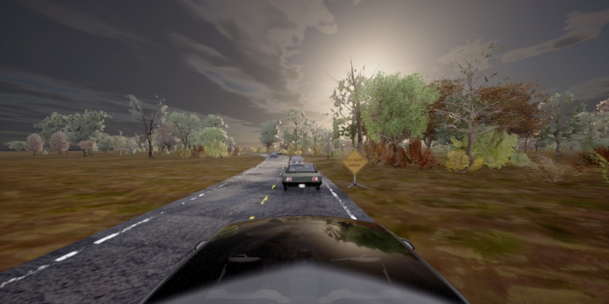
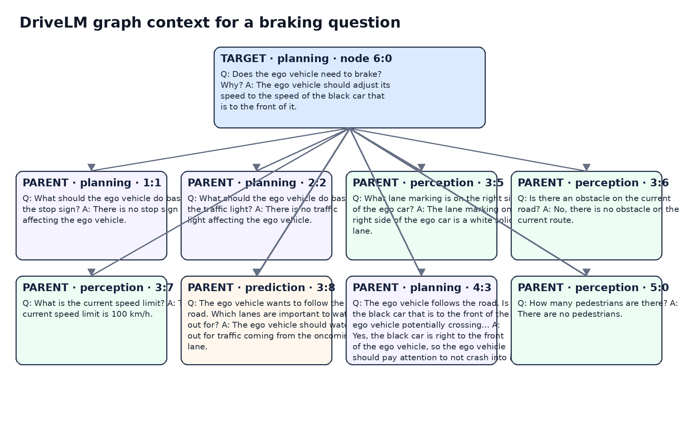

# DriveLM Graph Reasoning — Progress Document

**Prepared for preliminary professor feedback**  
**Date:** November 23, 2026  
**GitHub repository:** [github.com/jainish1p-code/DriveLM-GraphReasoning](https://github.com/jainish1p-code/DriveLM-GraphReasoning)

## 1. Project question

This project studies whether graph-structured QA context improves a
vision-language model's driving-planning answers.

The comparison is:

```text
Image only:
front-camera image + planning question

Gold graph context:
front-camera image + linked parent QA answers + planning question
```

The image and target planning question are identical in both conditions. Only
the graph context changes.

The project is inspired by DriveLM's representation of driving reasoning as a
directed graph connecting perception, prediction, and planning questions.

## 2. Change from the original proposal

The original proposal planned to use the DriveLM-nuScenes release for a
graph-context experiment. During the data audit, the released nuScenes QA files
contained null graph fields for all 377,956 processed QA records:
`con_up`, `con_down`, `cluster`, and `layer` were not populated. Because the
graph edges could not be reconstructed reliably, we did not invent or infer
edges from question text.

We moved the experiment to the DriveLM-CARLA release, which provides populated
graph links and matching PDM-Lite front-camera images. The research question is
unchanged—whether graph-linked QA context improves planning—but the dataset and
experimental scope changed.

The CARLA release also does not contain a separate behavior QA group, so the
current primary target is planning QA. Behavior/action interpretation remains a
secondary analysis rather than the required model output.

## 3. Current progress

### Completed

- Created a new reproducible GitHub repository.
- Downloaded and audited a DriveLM-CARLA pilot scenario.
- Verified 2,730 frames and 100% front-camera image coverage.
- Verified 16,199 planning QA records.
- Created a route-level train/validation split:
  - 2,098 training frames
  - 632 validation frames
- Audited the CARLA graph links and identified the preceding parent context for
  planning targets.
- Built matched image-only and gold-parent-context variants.
- Trained Qwen2-VL-7B-Instruct with 4-bit QLoRA.
- Added scripts for manifest creation, training, evaluation, graph auditing,
  qualitative inspection, and demo generation.
- Added an actual CARLA frame and QA graph visualization to the report.

### In progress

The next experiment is predicted parent context. A parent-answer model has been
trained on 31,065 perception, prediction, and planning QA records. Its
predictions are being generated for the validation parent nodes. Those generated
answers will then replace the gold parent answers in the planning prompts.

## 4. Preliminary results

The planning adapters were trained for 1,000 steps on the same 1,000-example
training subset and evaluated on all 3,673 validation planning QA records.

| Condition | Token F1 | ROUGE-L |
|---|---:|---:|
| Image only | 0.755 | 0.748 |
| Gold parent context | 0.846 | 0.834 |
| Absolute improvement | +0.092 | +0.086 |

Paired bootstrap 95% confidence intervals for the improvement were:

```text
Token F1:  [0.083, 0.101]
ROUGE-L:   [0.077, 0.097]
```

### Results by question category

| Category | N | Image-only F1 | Gold-context F1 | Gain |
|---|---:|---:|---:|---:|
| Brake | 632 | 0.258 | 0.701 | +0.444 |
| Lane or center | 632 | 0.655 | 0.659 | +0.005 |
| Other planning | 1,145 | 0.821 | 0.861 | +0.040 |
| Stop sign | 632 | 0.987 | 0.997 | +0.011 |
| Traffic light | 632 | 1.000 | 1.000 | 0.000 |

The largest gain is on braking questions. This is consistent with braking being
an aggregate decision that depends on several intermediate facts, such as
obstacles, traffic controls, speed limits, and predicted object interactions.

## 5. Concrete example

The following figure is generated from an actual CARLA frame. The target is a
braking question, and the graph contains eight linked parent QA nodes from
perception, prediction, and planning.





In the image-only condition, the model must infer the relevant evidence from
the image. In the gold-context condition, the model receives the linked parent
answers before answering the same planning question.

## 6. Interpretation and limitation

The preliminary result supports the hypothesis that graph context can improve
planning QA, especially for complex decisions.

However, the gold-context condition is an oracle condition: the parent answers
are taken directly from the dataset. In realistic inference, the model must
predict those parent answers first. A wrong parent answer could propagate an
error into planning.

There is also a possible answer-propagation effect. Some parent answers are
close paraphrases of their child planning answers. Therefore, the gold-context
gain should not be interpreted as purely improved visual perception.

Additional limitations:

- The current experiment uses one CARLA scenario.
- The model is trained on a 1,000-example subset rather than the full archive.
- Token F1 and ROUGE-L measure text overlap, not driving safety or collision
  avoidance.
- The released CARLA files contain perception, prediction, and planning QA but
  no separate behavior QA group.

## 7. Questions for feedback

I would appreciate feedback on the following directions:

1. Is the image-only versus gold-parent-context comparison a sufficiently
   focused project question, or should predicted parent context be required for
   the main result?
2. Is the one-scenario CARLA pilot acceptable for a preliminary project, or
   should the experiment expand to additional scenarios before finalizing the
   conclusions?
3. Should the gold-context result be presented primarily as an oracle upper
   bound because parent answers are supplied by the dataset?
4. Are token F1 and ROUGE-L adequate for this project, or should we add a
   semantic/action-level metric for braking, stopping, continuing, and turning?
## 8. Immediate next step

Complete the predicted-parent-context experiment:

```text
image
  -> predict parent perception/prediction/planning answers
  -> insert those predictions into the planning prompt
  -> evaluate the planning answer
```

This will show how much of the gold-context improvement survives when the model
must generate its own intermediate reasoning.

