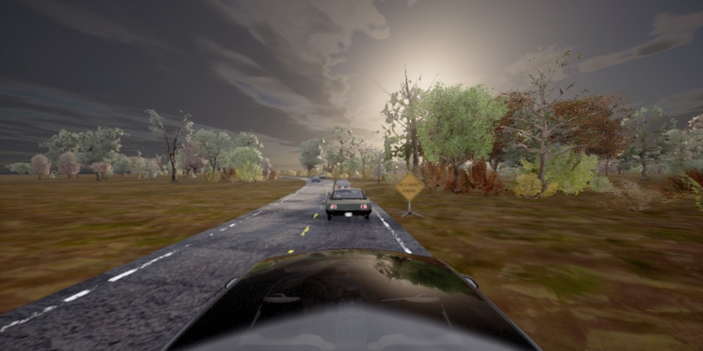
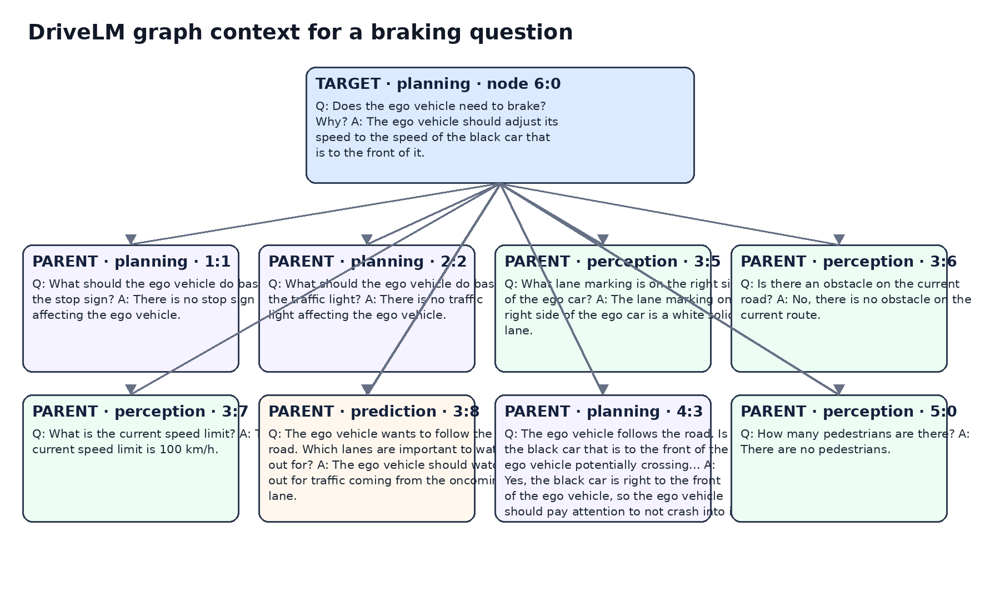

# DriveLM Graph Reasoning: Does QA Graph Context Improve Planning?

## Executive summary

Autonomous-driving systems must turn camera observations into safe driving
decisions. DriveLM represents this reasoning as a graph of linked questions and
answers: perception questions describe the scene, prediction questions reason
about what objects may do, and planning questions ask what the ego vehicle
should do.

This project tests one focused question:

> Does adding the answers from graph-linked parent questions improve a
> vision-language model's planning answers compared with using the camera image
> and planning question alone?

Using the DriveLM-CARLA pilot and Qwen2-VL-7B-Instruct, gold parent context
improved full-validation performance from token F1 `0.755` to `0.846` and
ROUGE-L `0.748` to `0.834`.

The largest improvement was on braking questions:

```text
Image only:          F1 = 0.258
Gold parent context: F1 = 0.701
Improvement:                   +0.444
```

The result supports the value of graph-structured reasoning, while also
showing an important limitation: gold parent answers are an oracle. A deployed
system would have to predict those parent answers first, so predicted parent
context is the natural next experiment.

## 1. Problem and motivation

Traditional autonomous-driving systems are usually modular. Separate modules
detect objects, track them, predict their motion, choose a maneuver, and then
control the vehicle. This modular structure is effective, but information is
often passed as fixed numerical representations and hand-designed interfaces.

DriveLM asks whether a vision-language model can use a more explicit reasoning
interface. Instead of asking the model to jump directly from an image to an
action, the system asks related questions in sequence. The answers form a
directed graph of reasoning steps.

The goal of this project is not to replace the low-level vehicle controller.
The goal is narrower: measure whether graph-connected language context helps a
VLM answer planning questions.

## 2. Dataset and graph structure

The experiment uses the `Town13/AccidentTwoWays` scenario from DriveLM-CARLA and
the corresponding PDM-Lite RGB images.

| Quantity | Value |
|---|---:|
| Total frames | 2,730 |
| Training frames | 2,098 |
| Validation frames | 632 |
| Training planning QA records | 12,526 |
| Validation planning QA records | 3,673 |
| Front-camera image coverage | 100% |
| Separate behavior QA records | 0 |

The split is by route group, so repetitions of the same route do not appear in
both training and validation.

Each frame contains many QA records. The planning target is only one record at
a time, but it can have links to perception, prediction, and other planning
records.

### Frame-level example

The representative validation frame is:

```text
Town13/AccidentTwoWays/Route13_Rep0/0010.json
```

Its braking target is:

```text
Question: Does the ego vehicle need to brake? Why?
Answer: The ego vehicle should adjust its speed to the speed of the black car
        that is to the front of it.
```

The target has eight parent QA records:

| Parent task | Parent question | Why it matters |
|---|---|---|
| Planning | What should the ego vehicle do based on the stop sign? | Stop-sign decision |
| Planning | What should the ego vehicle do based on the traffic light? | Traffic-light decision |
| Perception | What lane marking is on the right side? | Road layout |
| Perception | Is there an obstacle on the current road? | Obstacle status |
| Perception | What is the current speed limit? | Speed constraint |
| Prediction | Which lanes are important to watch out for? | Possible interaction |
| Planning | Is the car in front potentially crossing the path? | Collision risk |
| Perception | How many pedestrians are there? | Vulnerable road users |

The graph is therefore a compact record of the reasoning evidence available to
the planning question.





## 3. The two model inputs

The image and target question are identical in both conditions. Only the text
context changes.

### Condition A: image-only planning

```text
[Front camera image]

You are answering a driving-scene planning question from the camera image.
Question: Does the ego vehicle need to brake? Why?
Answer:
```

The model must infer the answer from the visual input and its learned
knowledge.

### Condition B: gold parent context

```text
[The same front camera image]

You are answering a driving-scene planning question. Use the preceding graph
QA context and the camera image.

Context QA 1:
Question: What should the ego vehicle do based on the stop sign?
Answer: There is no stop sign affecting the ego vehicle.

Context QA 2:
Question: What should the ego vehicle do based on the traffic light?
Answer: There is no traffic light affecting the ego vehicle.

...

Target question: Does the ego vehicle need to brake? Why?
Answer:
```

The second condition uses gold parent answers from the dataset. It is therefore
an oracle-context experiment: it measures the maximum benefit available when
the graph evidence is correct.

## 4. Model and training

- Base model: `Qwen/Qwen2-VL-7B-Instruct`
- Adaptation: 4-bit QLoRA
- GPU: NVIDIA A100-SXM4-40GB
- Trainable parameters: approximately 40.4 million
- Training steps: 1,000 per condition
- Training examples: 1,000 per condition
- Micro-batch size: 1
- Gradient accumulation: 4
- Output: free-form planning text

The target output remains natural language. The project does not force the
model to emit a hand-designed canonical action label.

## 5. Evaluation

The two adapters were evaluated on exactly the same 3,673 validation QA rows.

### Metrics

Token F1 measures token overlap between the prediction and reference answer.
ROUGE-L measures the longest common token subsequence. Both are useful for
tracking lexical agreement, but they are not perfect semantic measures: a
paraphrase can be correct while receiving a lower score.

### Full validation results

| Condition | Token F1 | ROUGE-L |
|---|---:|---:|
| Image only | 0.755 | 0.748 |
| Gold parent context | 0.846 | 0.834 |
| Absolute improvement | +0.092 | +0.086 |

Paired bootstrap 95% confidence intervals for the improvement were:

```text
Token F1:  [0.083, 0.101]
ROUGE-L:   [0.077, 0.097]
```

### Results by planning question

| Category | N | Image-only F1 | Gold-context F1 | Gain |
|---|---:|---:|---:|---:|
| Brake | 632 | 0.258 | 0.701 | +0.444 |
| Lane or center | 632 | 0.655 | 0.659 | +0.005 |
| Other planning | 1,145 | 0.821 | 0.861 | +0.040 |
| Stop sign | 632 | 0.987 | 0.997 | +0.011 |
| Traffic light | 632 | 1.000 | 1.000 | 0.000 |

## 6. What the result means

The strongest result is the brake category. Braking decisions combine several
types of evidence: obstacles, road layout, traffic controls, speed limits, and
predicted object interactions. The graph gives the model these intermediate
answers in a structured form.

The lane-center and traffic-light categories have little room for improvement
because the image-only model already performs strongly on them. Stop-sign
questions also illustrate a special property of graph context: the parent QA
can be almost a direct paraphrase of the target answer. This is useful for
multi-step answer generation, but it should not be described as entirely new
visual understanding.

The appropriate conclusion is therefore:

> Graph context improves planning QA, especially when the target decision
> depends on several intermediate reasoning steps. The gain is task-dependent
> and can partly reflect propagation of information already represented in
> parent answers.

## 7. Limitations

1. Gold parent answers are available in the second condition. This is an oracle
   upper bound rather than a complete deployed system.
2. The experiment uses one CARLA scenario and one route-level split.
3. The model is trained on a 1,000-example pilot subset rather than the full
   CARLA archive.
4. Token F1 and ROUGE-L do not fully capture semantic correctness.
5. The released CARLA files contain perception, prediction, and planning QA but
   no separate behavior QA group, so planning is the primary target.

## 8. Next experiment

The next realistic condition is predicted parent context:

```text
Image
  -> predict parent perception/prediction answers
  -> insert predicted answers as context
  -> answer planning question
```

This will measure error propagation and show how much of the gold-context gain
survives without access to ground-truth parent answers.

## Reproducibility commands

Build the matched variants:

```bash
PYTHONPATH=src python scripts/build_training_variants.py \
  --manifest-dir data/manifests \
  --output-dir data/manifests/variants
```

Train both conditions:

```bash
PYTHONPATH=src python scripts/train_planning_lora.py \
  --train-jsonl data/manifests/variants/planning_image_only_train.jsonl \
  --output-dir checkpoints/planning-image-only-1000 \
  --max-steps 1000 --max-samples 1000 \
  --gradient-accumulation-steps 4
```

```bash
PYTHONPATH=src python scripts/train_planning_lora.py \
  --train-jsonl data/manifests/variants/planning_gold_parent_context_train.jsonl \
  --output-dir checkpoints/planning-gold-context-1000 \
  --max-steps 1000 --max-samples 1000 \
  --gradient-accumulation-steps 4
```

Evaluate and compare:

```bash
PYTHONPATH=src python scripts/evaluate_planning_lora.py \
  --adapter checkpoints/planning-image-only-1000 \
  --jsonl data/manifests/variants/planning_image_only_validation.jsonl \
  --output reports/planning_image_only_1000_full.jsonl \
  --num-samples 3673 --seed 42
```

```bash
PYTHONPATH=src python scripts/evaluate_planning_lora.py \
  --adapter checkpoints/planning-gold-context-1000 \
  --jsonl data/manifests/variants/planning_gold_parent_context_validation.jsonl \
  --output reports/planning_gold_context_1000_full.jsonl \
  --num-samples 3673 --seed 42
```

```bash
PYTHONPATH=src python scripts/compare_planning_predictions.py \
  reports/planning_image_only_1000_full.jsonl \
  reports/planning_gold_context_1000_full.jsonl
```
